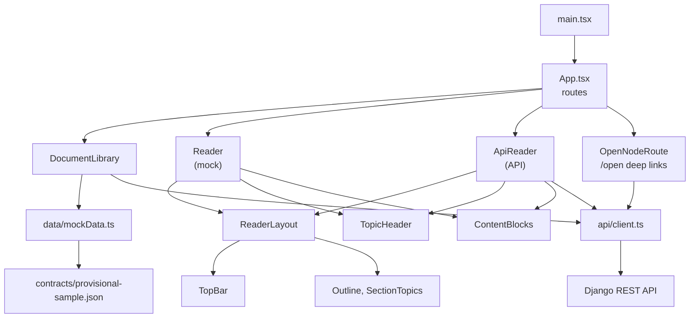

# Frontend guide

The frontend is a React single-page app in `frontend/`. It shows a document library and a manual reader, laid out for an iPad in landscape.

It can run against two data sources:

- **Mock** (the default): data comes from `contracts/provisional-sample.json`. No network calls are made.
- **API**: data comes from the Django REST API. Set `VITE_DATA_SOURCE=api` and run the backend on port 8000.

- [Architecture](#architecture)
- [Data source](#data-source)
- [Routing](#routing)
- [Screens and components](#screens-and-components)
- [Content blocks](#content-blocks)
- [Deep links](#deep-links)
- [TypeScript types](#typescript-types)
- [Mock data](#mock-data)
- [Styling and responsive behaviour](#styling-and-responsive-behaviour)
- [Testing](#testing)
- [Known gaps](#known-gaps)

## Architecture



| File | Role |
|---|---|
| `src/main.tsx` | Renders `<App />` in `StrictMode` and imports `styles.css` |
| `src/App.tsx` | Defines the routes. Exports `AppRoutes` (used by tests) and `App` wrapped in `BrowserRouter` |
| `src/config/dataSource.ts` | Reads `VITE_DATA_SOURCE` and `VITE_API_BASE_URL` |
| `src/api/client.ts` | Typed fetch functions. Every response is shape-checked before use |
| `src/data/mockData.ts` | Synchronous mock equivalents of the API functions |
| `src/types/api.ts` | Types for every API response |
| `src/components/DocumentLibrary.tsx` | Library page (mock and API versions) |
| `src/components/Reader.tsx` | Reader page for mock data |
| `src/components/ApiReader.tsx` | Reader page for API data, with loading, error and retry states |
| `src/components/ReaderLayout.tsx` | Shared reader frame: top bar, sidebar, breadcrumbs, content area, right panel, status bar |
| `src/components/TopBar.tsx` | The grey bar at the top of every page |
| `src/components/Outline.tsx` | Chapter, section and topic sidebar; the "In this section" panel; breadcrumb helper |
| `src/components/TopicHeader.tsx` | Topic number, title and revision details |
| `src/components/ContentBlocks.tsx` | Renders a topic's blocks, including cross-reference links |
| `src/components/OpenNodeRoute.tsx` | Resolves `/open?doc=…&node=…` links through the API |
| `src/components/RevisionSelector.tsx` | Revision chip, or a dropdown when several revisions exist |
| `src/components/RequestStates.tsx` | Loading, empty and error messages |
| `src/components/NotFound.tsx` | Unknown routes |
| `src/utils/formatDate.ts` | Turns `2026-07-15` into `15 Jul 2026` |
| `src/utils/readerLink.ts` | Builds a reader URL from a resolver response |
| `src/styles.css` | All styles |

There is no global state library. State lives in component state inside each reader.

## Data source

`src/config/dataSource.ts` exports two values:

| Variable | Values | Default |
|---|---|---|
| `VITE_DATA_SOURCE` | `mock` or `api`. Anything else throws at startup | `mock` |
| `VITE_API_BASE_URL` | Prefix for API requests, trailing slashes removed | empty, so requests go to the same origin |

In development, `vite.config.ts` proxies `/api` to `http://127.0.0.1:8000`, so the base URL can stay empty. To run in API mode:

```sh
cd frontend
VITE_DATA_SOURCE=api npm run dev
```

`DocumentLibrary` and `Reader` check `DATA_SOURCE` and render either the mock or the API version.

### API client

All functions in `src/api/client.ts` return `ApiResult<T>`: either `{ ok: true, data }` or `{ ok: false, error }`. They never throw. Every function accepts an `AbortSignal`, and the readers cancel requests when the route changes.

| Function | Endpoint |
|---|---|
| `getDocumentLibraryFromApi` | `GET /api/documents/` |
| `getRevisionNavigationFromApi` | `GET /api/documents/{docId}/revisions/{revision}/navigation/` |
| `getTopicContentFromApi` | `GET /api/documents/{docId}/revisions/{revision}/topics/{topicId}/` |
| `resolveNodeFromApi` | `GET /api/documents/{docId}/resolve-node/?nodeId=…[&revision=…]` |

Errors are classified as `network`, `non-json`, `invalid-json`, `invalid-response`, `http` or `aborted`. HTTP errors keep the contract's `code`, `message` and `details`.

## Routing

| Path | Component | Notes |
|---|---|---|
| `/` | `DocumentLibrary` | Home page |
| `/reader/:docId/:revision` | `Reader` | Optional query: `nodeId`, plus `topicId`, `chapterId`, `sectionId` and `targetType` when opened by the resolver |
| `/open?doc=…&node=…[&rev=…]` | `OpenNodeRoute` | Permanent-ID entry point. Calls the resolver, then redirects to the reader. API mode only |
| `*` | `NotFound` | "Page not found" |

## Screens and components

### Document library

A compact table with one row per document:

| Column | Content |
|---|---|
| Document | Document type (for example `FM`), title, and document ID underneath |
| Revision | The revision number, or a revision dropdown if the document has more than one |
| Revision date, Effective date | Formatted as `1 Jul 2026` |
| Status | Chip showing Current, Upcoming or Superseded, from the API's revision status |
| (action) | "Open" button, labelled for screen readers as "Open {title}" |

The whole row opens the reader. Taps on the button or the dropdown keep their own behaviour.

### Reader

`Reader` (mock) and `ApiReader` (API) own the data loading, topic selection and deep-link logic. Both render the same frame through `ReaderLayout`:

| Area | Content |
|---|---|
| Top bar | "Pilot EFB" (links to the library), manual title, `{docId} · Revision {n}`, "Back to library" |
| Left sidebar | "Contents": chapters and sections expand and collapse; topics open. Numbers are shown in monospace. The open topic has a blue bar |
| Breadcrumbs | Document type, then chapter, section and topic titles |
| Content | `TopicHeader`, then `ContentBlocks` |
| Right panel | "In this section": the section containing the open topic, and its topics. Tapping one opens it |
| Status bar | Pinned to the bottom: topic number, section and topic title, classification, revision and effective date |

The right panel lists sibling topics rather than headings within the page, because a topic's blocks have no headings of their own. The Figma design calls this panel "On this page".

The sidebar scrolls itself so the open topic stays visible, for example after a deep link opens a topic far down the list.

`ApiReader` also validates that every response matches what was requested (document, revision, topic and its parents). A mismatch is shown as an error rather than displayed.

## Content blocks

`ContentBlocks` switches on each block's `type`:

| Block type | Rendered as |
|---|---|
| `para` | A paragraph |
| `note`, `caution`, `warning` | An `<aside>` with a label and a coloured left bar: grey for note, amber for caution, red for warning |
| `list` | A bulleted list |
| `table` | A table in a keyboard-focusable scroll region. Rows flagged `header` render as column headers |
| `checklist` | One row per check: a checkbox, the challenge, a dotted leader, and the response in monospace. Ticked rows turn grey. The heading shows progress (for example "3 of 12") and a Reset button once anything is ticked |

- **Element IDs:** every block and every checklist check is rendered with its permanent ID as the HTML `id`. This is what makes scroll-to-target work.
- **Cross-references (mock):** a link is shown only if the target exists in the mock data. Otherwise the text is followed by "Not available in this prototype."
- **Cross-references (API):** the link points at `/open?…`. Clicking it calls the resolver and then navigates. The resolver is not called until the link is used. A missing target shows "Not available in this revision."
- **Checklist ticks** are kept in reader state, keyed by check ID. They survive switching topics but are lost on reload. Nothing is saved.
- **Checklist reset:** Reset unticks every check in that one checklist. There is deliberately no "check all": each item should be confirmed individually.

## Deep links

Links always use the permanent ID. Nothing resolves by number, title or page.

**Mock mode:** `/reader/FM-S100/2?nodeId=fm100-p03219` is resolved by `resolveAvailableTargetId` against the mock topics.

**API mode:** `/open?doc=FM-S100&node=fm100-p03219` (optionally `&rev=2`) calls the backend resolver, which returns the document, revision, chapter, section and topic. The app then redirects to the reader with those IDs in the query. An explicit revision is never silently replaced with a different one.

In both modes the reader then:

1. opens the topic and expands its chapter and section in the sidebar;
2. scrolls the target into view;
3. highlights it with a blue tint and outline for about 2.2 seconds, then fades it out.

A target that is not in the topic shows a status message instead.

## TypeScript types

API response types live in `src/types/api.ts` and mirror the provisional contract.

| Type | Describes |
|---|---|
| `DocumentMetadata` | The XML `meta` fields |
| `DocumentRevision`, `DocumentSummary`, `DocumentLibraryResponse` | Library endpoint |
| `Chapter`, `Section`, `Topic`, `RevisionNavigationResponse` | Navigation endpoint |
| `ContentBlock` | Union of text, list, table and checklist blocks, discriminated by `type` |
| `TopicContentResponse` | Topic endpoint |
| `ResolveNodeResponse` | Resolver endpoint |

`src/data/mockData.ts` adds `Mock…` variants with an optional `mock` flag. That flag is frontend-only and is not part of the API.

`tsconfig.json` enables `strict`, `noUnusedLocals`, `noUnusedParameters` and `noFallthroughCasesInSwitch`.

## Mock data

`mockData.ts` imports `contracts/provisional-sample.json` at build time:

| Function | Returns |
|---|---|
| `getDocumentLibrary()` | The documents in the sample |
| `getNavigationTree(docId, revision)` | The sample outline plus a mock "Examples" chapter |
| `getTopic(docId, revision, topicId)` | One of two topics |
| `resolveAvailableTargetId(docId, revision, targetId)` | The topic containing a target ID, if any |

The mock data contains FM-S100 Rev 2 only, with one real topic (`fm100-t0340`, "Autothrottle Crew Awareness") and one mock topic (`fm100-t1086`, "Transponder Reset Guidance") that demonstrates the table renderer. The mock chapter, section and topic carry a "MOCK" badge.

## Styling and responsive behaviour

All styles are in `src/styles.css`: plain CSS, no framework. Shared values are custom properties on `:root`:

| Property | Use |
|---|---|
| `--ink`, `--muted`, `--line` | Text, secondary text, dividers |
| `--surface`, `--soft-surface` | White page, light grey bars and sidebar |
| `--accent`, `--accent-soft` | Blue for active items, links, chips and highlights |
| `--warning`, `--caution` | Red and amber callout colours |
| `--mono` | Monospace font for numbers, IDs and dates |
| `--bar-height`, `--status-height` | Top bar and status bar heights; the sidebar height is calculated from them |

| Screen width | Behaviour |
|---|---|
| Narrow | The sidebar is hidden. "Open navigation" slides it in as a drawer over a dimmed backdrop |
| 900px and wider, or 760px and wider in landscape | The sidebar is shown as a sticky column |
| 1180px and wider | The "In this section" panel is shown as a third column |
| 700px and narrower | The status bar hides the revision text |

Touch and accessibility details:

- Buttons and rows are at least 44px tall.
- Visible focus outlines on buttons, links, inputs and focusable regions.
- Labelled regions for navigation, breadcrumbs, content, the section panel, tables and checklists.

**Not verified:** the layout has not been tested on a real iPad. It has been checked in desktop Chrome at iPad sizes. Tests run in jsdom, which does not apply CSS layout or media queries.

## Testing

Run from `frontend/`:

```sh
npm test                 # all tests, once
npx tsc --noEmit -p .    # type check
npm run build            # type check and production build
```

Result at the time of writing: **42 tests in 4 files, all passing.** All tests use Vitest, React Testing Library and jsdom.

| File | Covers |
|---|---|
| `src/App.test.tsx` | Library and reader in mock mode: outline, block order, lists, tables, checklists and checklist reset, deep-link highlight, warnings, cross-references |
| `src/api/client.test.ts` | Endpoint URLs, response validation, error handling for 404s, malformed JSON, invalid shapes, network failures and non-JSON responses |
| `src/components/ApiIntegration.test.tsx` | API mode: library loading, empty and retry states, revision handling, lazy cross-reference resolution, `/open` links |
| `src/components/Preparation.test.tsx` | Data source default, revision selector, request states, not-found route, no fetches in mock mode |

**Not covered:** real devices, visual layout, accessibility audits, the sidebar auto-scroll (jsdom cannot measure positions), and anything requiring a running backend.

## Known gaps

- Manually selected topics are not stored in the reader URL, so reloading returns to the first topic. Only resolver-opened topics are in the query.
- The right panel shows sibling topics, not headings within a topic.
- Mock-mode revision parsing is looser than API mode.
- Whitespace in XML mixed text is passed through unchanged; the contract leaves normalisation open.
- In production builds the Vite proxy does not exist, so `VITE_API_BASE_URL` must point at the API.
- Search, annotations, revision comparison, dark mode, offline storage, read-and-sign, integrity and admin screens are not built yet.
